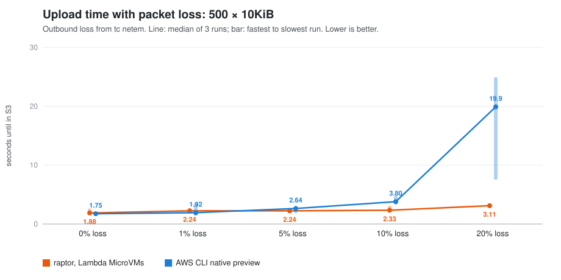

# Benchmark: upload time with packet loss, 2026-11-19

Raw data: [`results.csv`](results.csv) (the `loss_pct` column is the simulated loss). Chart: `bench/charts.py --loss`.

## Setup

- **Workload:** 500 files of 10 KiB, one folder, uploaded with one command. Of the [small-file
  workloads](../small-files/README.md), this is the one where raptor and the native AWS CLI were closest without
  loss (1.88 s and 1.72 s).
- **Tools:** raptor (Lambda MicroVMs, `--rate-mbps 30`, four 2 GB MicroVMs) and the AWS CLI native preview
  `2.40.0-preview1` (CRT client, `target_throughput = 35Mb/s`, not rate limited). 3 runs each, interleaved.
- **Loss:** `tc qdisc add dev eth0 root netem loss N%` on the client (WSL 2, home connection with about 35-38 Mbps up,
  to us-west-2). netem drops each outbound packet independently with probability N: raptor's UDP datagrams and the
  AWS CLI's TCP segments alike. Inbound packets (raptor's replies, TCP's acknowledgements) are not dropped.
  `bench/loss-benchmark.sh` sets each level, runs `bench/benchmark.sh`, and removes the qdisc afterwards.
- **Measurement:** time from start until an S3 listing shows all 500 files with the right size. All 30 runs passed.

## Results (seconds until in S3)

| Loss | raptor, median (fastest-slowest) | AWS CLI native, median (fastest-slowest) |
|---|---|---|
| 0% | 1.88 (1.83-2.35) | **1.75** (1.69-1.79) |
| 1% | 2.24 (2.08-2.36) | **1.92** (1.70-3.26) |
| 5% | **2.24** (2.19-2.26) | 2.64 (2.13-2.66) |
| 10% | **2.33** (2.22-2.82) | 3.80 (3.59-4.52) |
| 20% | **3.11** (3.00-3.18) | 19.9 (7.81-24.7) |

## Findings

1. **raptor barely notices loss.** From 0% to 10% its median rose from 1.88 s to 2.33 s, and at 20% it was 3.11 s.
   Repair needs no round trip per lost packet: the client estimates the loss rate as it goes and sends that many repair
   symbols up front, so most files decode from the first pass. Repair rounds then send exactly what each MicroVM says
   it still needs.
2. **TCP slows down sharply.** The AWS CLI took 1.5 times as long at 5% loss, 2.2 times at 10%, and 11 times (median)
   at 20%, where its runs also varied from 7.8 s to 24.7 s. TCP reads each loss as congestion and cuts its sending
   rate, and lost handshake and TLS packets add retransmission timeouts of a second or more.
3. **The crossover is between 1% and 5%.** Without loss the uncapped AWS CLI is a little faster on this link (raptor
   was capped at 30 Mbps, the link carries about 35-38 Mbps). From 5% raptor is faster, and the gap widens with loss.
   At 20%, raptor was 6.4 times faster.
4. **raptor's run-to-run spread stays small** (at most 0.6 s at every level). The AWS CLI's grows with loss, so its
   upload time also becomes hard to predict.

## Caveats

- netem loss is random and independent. Real loss often comes in bursts (`netem loss 5% 25%` adds correlation), and
  congestion loss on a real path also brings delay, which this test doesn't add.
- Only outbound packets were dropped. On real paths, replies and acknowledgements are lost too.
- The WSL 2 wall clock on this host steps forward about 1.7 s every 34 s, which can add up to 1.7 s to any one run.
