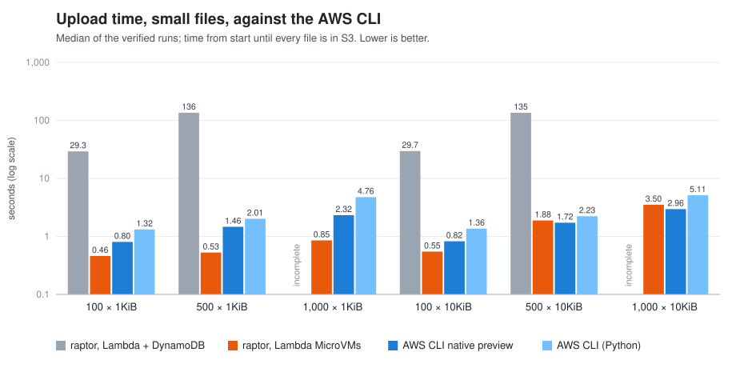
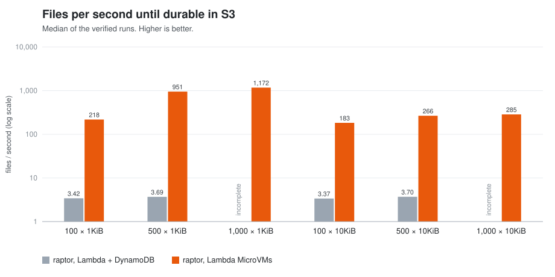
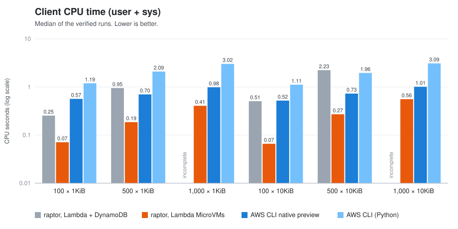

# Benchmark: small files, 2026-11-19

Raw data: [`results.csv`](results.csv). Charts are drawn from it by `bench/charts.py`.

## Setup

- **Client:** WSL 2 (Ubuntu 24.04) on Windows, 22 CPUs, home connection with about 35-38 Mbps up, to us-west-2.
- **Workloads:** a folder of 100, 500 or 1,000 random files of 1 KiB, then of 10 KiB, uploaded with one command per
  tool (`--recursive`).
- **Tools**, 3 runs each, interleaved:
  - **raptor, Lambda MicroVMs** (this repository's `raptor2` CLI and `microvm/template.yaml`): four 2 GB MicroVMs (the
    default `--small-slots 4`), warmed with one upload before the run.
  - **raptor, Lambda + DynamoDB**: [the original design](../../original-design.md) (`raptor` CLI and
    `template.json`), over WireGuard, `--confirm BLOCK`.
  - **AWS CLI native preview** `2.40.0-preview1` (commit 1cc2b048), `AWS_CLI_NATIVE_ROUTER=native`, CRT client,
    `target_throughput = 35Mb/s`, `aws s3 cp --recursive`.
  - **AWS CLI (Python):** the same build with `AWS_CLI_NATIVE_ROUTER=python`.
- **Rates:** both raptor CLIs were limited to 30 Mbps (`--rate-mbps 30`); the AWS CLI was not limited.
- **Measurement:** the time from start until an S3 listing shows every file with the right size. Client CPU is
  user + sys time. Medians of the runs that passed verification. `bench/benchmark.sh` with
  `WORKLOADS="100x1KiB 500x1KiB 1000x1KiB 100x10KiB 500x10KiB 1000x10KiB" REPEAT=3 RATE_MBPS=30`.

## Results

| Files | Lambda + DynamoDB | **Lambda MicroVMs** | AWS CLI native | AWS CLI (Python) |
|---|---|---|---|---|
| 100 × 1 KiB | 29.3 s (1 of 3 runs complete) | **0.46 s** | 0.80 s | 1.32 s |
| 500 × 1 KiB | 136 s | **0.53 s** | 1.46 s | 2.01 s |
| 1,000 × 1 KiB | incomplete (0 of 3) | **0.85 s** | 2.32 s | 4.76 s |
| 100 × 10 KiB | 29.7 s (2 of 3) | **0.55 s** | 0.82 s | 1.36 s |
| 500 × 10 KiB | 135 s | 1.88 s | **1.72 s** | 2.23 s |
| 1,000 × 10 KiB (1 run each) | incomplete | 3.50 s | **2.96 s** | 5.11 s |

Client CPU time (user + sys):

| Files | Lambda + DynamoDB | **Lambda MicroVMs** | AWS CLI native | AWS CLI (Python) |
|---|---|---|---|---|
| 100 × 1 KiB | 0.25 s | **0.07 s** | 0.57 s | 1.19 s |
| 500 × 1 KiB | 0.95 s | **0.19 s** | 0.70 s | 2.09 s |
| 1,000 × 1 KiB | - | **0.41 s** | 0.98 s | 3.02 s |
| 100 × 10 KiB | 0.51 s | **0.07 s** | 0.52 s | 1.11 s |
| 500 × 10 KiB | 2.23 s | **0.27 s** | 0.73 s | 1.96 s |
| 1,000 × 10 KiB | - | **0.56 s** | 1.01 s | 3.09 s |

## Findings

1. **For 1 KiB files, the MicroVM design is 1.7 to 2.8 times faster than the native AWS CLI**, and the lead grows
   with the number of files: 0.46 s against 0.80 s for 100 files, 0.85 s against 2.32 s for 1,000. It uses 12-42% of
   the CPU time. A file is in S3 when the reply to its last packet arrives, so "CLI exit" and "in S3" are the
   same moment.
2. **Against the original design, it is 64 to 260 times faster.** Holding the symbols in MicroVM memory removes the
   DynamoDB writes, the SQS hops and the second Lambda invocation per file. The original took about 0.27 s per file
   from this client, nearly constant with the number of files.
3. **From about 500 files of 10 KiB, the upload is limited by the link, not the protocol.** 500 × 10 KiB is 5 MB:
   at raptor's 30 Mbps cap that alone is 1.4 s, while the uncapped AWS CLI used the whole 35-38 Mbps uplink. Both
   are near the link's limit there.

## Caveats

- **The account limits the original design.** Its Lambda concurrency limit is 10 (the AWS default is 1,000), and its
  functions are limited to 3,008 MB (the template asks for 4,096 MB for the decoder). The block completer was
  throttled during the run, and the incomplete runs (files still missing two minutes after the CLI finished) are
  most likely a result of it. In an account with default limits the original would do better, but its per-file
  pipeline (two functions, a FIFO queue and DynamoDB round trips) stays.
- One run of the original stopped after 5 s because its WireGuard handshake timed out (100 × 1 KiB, run 2).
- The run was stopped during the last workload, so 1,000 × 10 KiB has one run per tool.
- The WSL 2 wall clock on this host steps forward about 1.7 s every 34 s. That can add up to 1.7 s to any one
  run. Medians of 3 reduce it.
