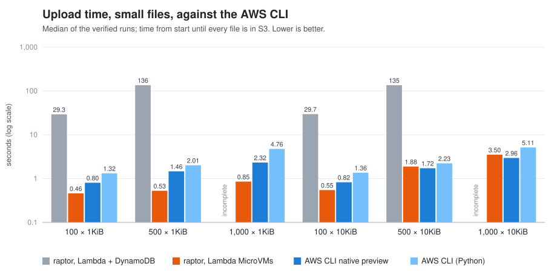
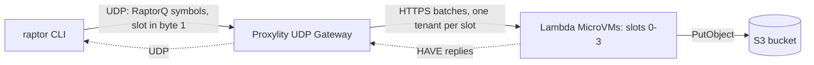
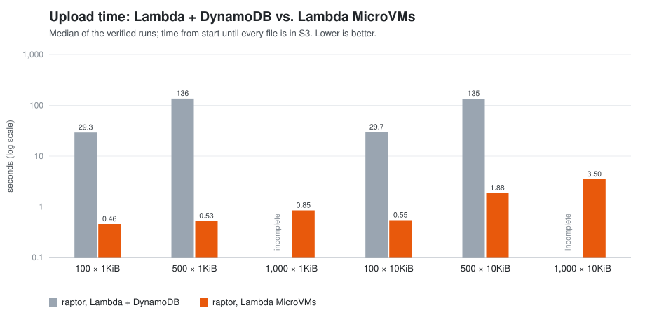
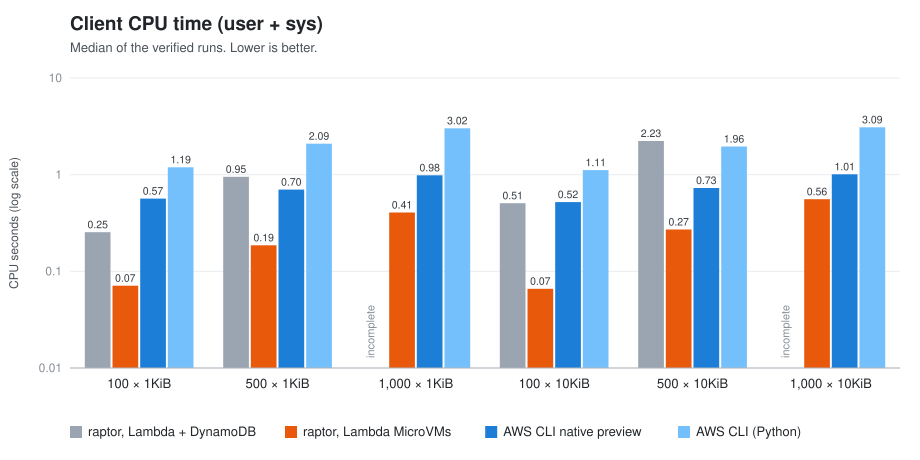
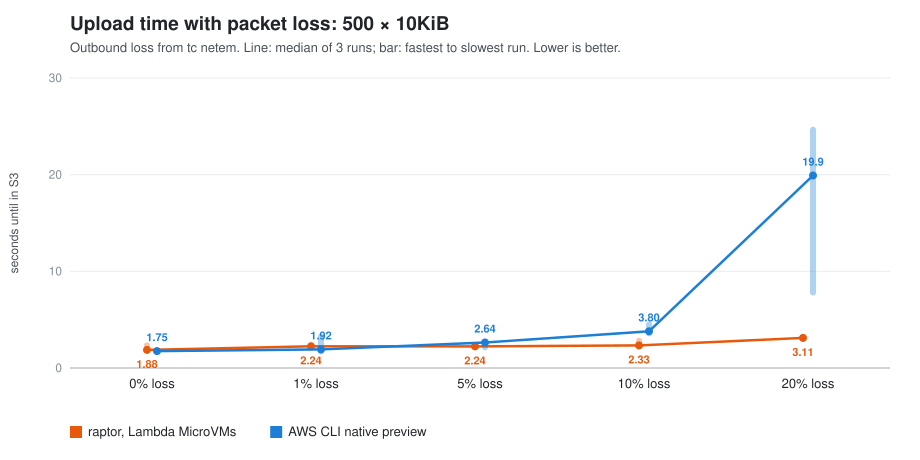

# Raptor: Fast Small File Transfers to S3



Raptor puts small files into S3 faster than the AWS CLI, using a fraction of the client CPU. It doesn't use HTTP, TLS
or TCP. The client encodes each file with RaptorQ and fires the symbols at a [Proxylity UDP
Gateway](https://proxylity.com) listener over UDP (optionally inside WireGuard). The gateway batches them to a pool of
[Lambda MicroVMs](https://docs.aws.amazon.com/lambda/latest/dg/lambda-microvms-guide.html), which reassemble the files
in memory and write them to your bucket. There is no handshake before the data, and no per-packet storage behind it.

## Background

Moving small files to S3 is slow. AWS has done a lot to raise S3 throughput, including the [Common Runtime (CRT)
transfer client](https://github.com/awslabs/aws-c-s3) and the [native (Rust) AWS CLI](https://github.com/aws/aws-cli/issues/10912),
but S3's API is HTTPS, and the [expected floor for small object latency is about 100-200 ms per
request](https://docs.aws.amazon.com/AmazonS3/latest/userguide/optimizing-performance.html). For files under about
10 KB the TLS and HTTP overhead dominates both the time and the CPU.

[RaptorQ](https://datatracker.ietf.org/doc/html/rfc6330) is a fountain code: any large enough set of encoded symbols,
in any order, rebuilds the original. That makes it a good fit for fire-and-forget delivery over UDP, where some
packets are lost and the rest arrive in any order.

## How it works



1. **The client sends without asking first.** Every datagram says what it belongs to: a random transfer ID, the
   file's index and size, its block and symbol number, and (in some packets) its S3 key. A 1 KiB file is two
   datagrams: one source symbol and one repair symbol. The number of repair symbols adapts to the loss the client
   measures.
2. **The slot is the tenant.** The client writes a slot number into byte 1 of each datagram, chosen from the transfer
   ID and the file, and the gateway's `TenantIdExpression: "[1:2]"` routes each slot to its own MicroVM. Slots are
   shared by all uploads, so the MicroVMs stay warm.
3. **The MicroVM holds the state.** It keeps each file's symbols in memory until it has enough, decodes if
   anything was lost, and writes the file with one `PutObject`. Only then does it answer, in the HTTP response to the
   batch that completed the file. The gateway sends that reply to the client as a UDP datagram.
4. **The client repairs what's missing.** Files with no reply get a `STATUS` query after a short timeout, and then
   exactly the symbols the MicroVM says it still needs.

### Why MicroVMs: where the state lives

The [original raptor](docs/original-design.md) ran the same protocol on Lambda functions. A function keeps no memory
between invocations, and several invocations for one file can run at once, so the state had to live somewhere else:

| | Original: Lambda + SQS + DynamoDB | Now: Lambda MicroVMs |
|---|---|---|
| Where received symbols wait | One DynamoDB item per symbol | In the MicroVM's memory |
| How a file is known to be complete | Atomic counters in DynamoDB, then a FIFO SQS message so it is decoded once | The MicroVM counts its own symbols |
| Who decodes and writes to S3 | A second Lambda function, after reading the symbols back from DynamoDB | The same MicroVM, at once |
| AWS calls per 1 KiB file | DynamoDB writes and reads, SQS messages, two Lambda invocations, several S3 requests | One `PutObject` |
| Infrastructure | 2 queues, a table, 2 functions in the data path (and Lambda concurrency for them) | One MicroVM image |

Each hop in the original added latency, and each file paid for DynamoDB writes. With the state in memory, a file is
in S3 as soon as its last packet is processed.

## Benchmarks

Uploads from a home connection (about 35 Mbps up) to us-west-2, from WSL 2 on Windows: 100, 500 and
1,000 files of 1 KiB and of 10 KiB, each tool 3 times, interleaved. Times run from the start until every file is
verified in S3. Details, raw data and caveats: [docs/benchmarks/small-files](docs/benchmarks/small-files/README.md).

| Files | Lambda + DynamoDB (original) | **Lambda MicroVMs** | AWS CLI native preview | AWS CLI (Python) |
|---|---|---|---|---|
| 100 × 1 KiB | 29.3 s | **0.46 s** | 0.80 s | 1.32 s |
| 500 × 1 KiB | 136 s | **0.53 s** | 1.46 s | 2.01 s |
| 1,000 × 1 KiB | incomplete | **0.85 s** | 2.32 s | 4.76 s |
| 100 × 10 KiB | 29.7 s | **0.55 s** | 0.82 s | 1.36 s |
| 500 × 10 KiB | 135 s | 1.88 s | **1.72 s** | 2.23 s |
| 1,000 × 10 KiB (1 run) | incomplete | 3.50 s | **2.96 s** | 5.11 s |

- **1 KiB files:** 1.7 to 2.8 times faster than the native AWS CLI, with 12-42% of its CPU time, and
  64 to 260 times faster than the original design.
- **10 KiB files:** faster up to a few hundred files. Beyond that the uplink is the limit: both raptor CLIs were capped
  at 30 Mbps, and the AWS CLI used the whole 35-38 Mbps.
- The original design ran in an account with a Lambda concurrency limit of 10, which throttled it; "incomplete" means
  files were still missing two minutes after its CLI finished.





### With packet loss

On a lossy link the difference grows. With simulated loss (`tc netem`, outbound packets on the client), 500 files of
10 KiB, where the two were closest without loss:

| Loss | **Lambda MicroVMs** | AWS CLI native preview |
|---|---|---|
| 0% | 1.88 s | **1.75 s** |
| 1% | 2.24 s | **1.92 s** |
| 5% | **2.24 s** | 2.64 s |
| 10% | **2.33 s** | 3.80 s |
| 20% | **3.11 s** | 19.9 s |



Raptor sends repair symbols in proportion to the loss it measures, so lost packets don't cost round trips. TCP
treats every loss as congestion and slows down. Details: [docs/benchmarks/packet-loss](docs/benchmarks/packet-loss/README.md).
The comparison tools are the [AWS CLI native preview](https://github.com/aws/aws-cli/issues/10912) (`2.40.0-preview1`,
Rust path, CRT client) and the same CLI on its Python path, both with `aws s3 cp --recursive`.

## Getting started

Prerequisites: Linux or WSL 2 with the .NET 10 SDK and gcc or clang, SAM CLI, an AWS CLI with the
`lambda-microvms` commands, `jq` and `zip`, and a [Proxylity UDP Gateway
subscription](https://aws.amazon.com/marketplace/pp/prodview-cpvl5wgt2yo2e) (a free tier is available).

```bash
microvm/scripts/deploy.sh                       # builds, deploys stack raptor2 in us-west-2, prints the endpoint
microvm/build/cli/raptor2 photos udp://<host>:<port> --recursive
aws s3 ls s3://<bucket>/decoded/ --recursive
```

`deploy.sh` allows only your current public IP address to send to the listener (`CLIENT_CIDR` changes it). It creates
a bucket named `<stack>-objects-<account>` unless you pass `ExistingBucketName`. See [microvm/](microvm/README.md) for
deployment options, local testing without AWS, and operating notes.

## CLI

```
raptor2 <file|folder> <udp|wg>://<host>:<port> [options]

  --recursive             include subfolders
  --prefix <p>            key prefix (default: a UTC timestamp); --no-prefix uses the relative paths only
  --rate-mbps <n>         send rate limit (default 10)
  --small-slots <n>       MicroVMs to spread files across (default 4)
  --max-size <n>          largest file to send (default 1MiB); see "Limits"
  --overhead <f|auto>     repair symbols sent up front (default auto: adapts to the measured loss)
  --timeout <s>           give up after this long without progress (default 60)
  --no-confirm            fire and forget: don't wait for the files to be confirmed
  --server-key/--client-key <base64>   WireGuard keys, for wg://
  --verbose | --silent
```

The exit code is 0 when every file is in S3.

## Limits

- **Files up to 1 MiB by default.** Larger files are refused, with a pointer to `aws s3 cp`. `--max-size` raises the
  limit: files over 16 MiB then go as S3 multipart uploads, with their parts spread over the large-file lanes
  (`--large-slots`). That works, but it isn't benchmarked here, and it isn't the point: each MicroVM accepts a limited
  number of requests per second, so large-file throughput costs MicroVM capacity that a direct S3 upload doesn't
  need. See [the design notes](docs/design-microvm.md#file-size-limit-and-why).
- **Object keys up to 95 bytes**, including the prefix.
- **MicroVM memory quota.** Each slot in use is one MicroVM. The default quota is 8 GB, which is the CLI's default of
  four 2 GB MicroVMs.
- **The first upload after an idle period** resumes or starts the MicroVMs. A 1 KB upload took 0.9-4.4 s this way,
  against 0.12-0.2 s with warm MicroVMs. Packets that arrive in the meantime are repaired.

## Cost

These are the AWS costs of the backend. Proxylity's per-packet charges are left out; they are the same for both designs.
The MicroVM figures use the [published](https://aws.amazon.com/lambda/pricing/) Graviton (Arm) rates for us-east-1:
$0.0000276944 per vCPU-second and $0.0000036667 per GB-second, $0.0038 per GB written to a snapshot (suspend) and
$0.00155 per GB read from one (start or resume). Those rates apply if you deploy the Arm64 build
(`RID=linux-arm64 microvm/scripts/deploy.sh`). The default x86_64 build and other regions are priced on the same page.

**What you pay for**

| Item | Unit cost | With the defaults (four 2 GB MicroVMs) |
|---|---|---|
| A MicroVM while it runs (2 GB, 1 vCPU baseline) | $0.126 an hour ($0.0021 a minute) | $0.50 an hour |
| Suspending a MicroVM (writing its 2 GB snapshot) | $0.0076 | $0.030 |
| Resuming or starting a MicroVM (reading its snapshot) | $0.0031 | $0.012 |
| A suspended MicroVM's snapshot | $0.16 a month | $0.64 a month |
| Each file: one S3 `PutObject` | $0.005 per 1,000 files | |

A MicroVM runs from the first packet it receives until `IdleDurationSeconds` (900 by default) after the last one.
Then it suspends, and the next packet resumes it. So the MicroVM cost depends on how long the MicroVMs stay awake, not
on how many files they receive.

**Examples**

- **One upload of 1,000 small files after a quiet spell.** Resume ($0.012), about 15 minutes awake ($0.126), suspend
  ($0.030), and 1,000 `PutObject`s ($0.005): **about $0.17 in all.** With `IdleDurationSeconds=60` the MicroVMs are
  awake for about a minute ($0.008), and the total is **about $0.06**. More uploads in the same awake period add
  only their `PutObject`s and the extra minutes.
- **Steady traffic, so the MicroVMs never suspend.** $0.50 an hour, or about $370 a month. The four MicroVMs took
  1,000 files in 0.85 s in the benchmark, so at full use that is well under a cent per 1,000 files on top of the
  `PutObject`s.

**Against the original design.** The original paid per file instead, with no cost while idle. A 1 KiB file was two
packets, and each packet was a DynamoDB item, written and read back, plus counter and lock items: about $0.012 per
1,000 files in DynamoDB (see [cost-analysis.md](docs/cost-analysis.md)). Each file also took four PUT-class S3 requests
and a GET (create a multipart upload, put and get a staging object, upload a part, complete), about $0.02 per 1,000
files. That is about $0.03 per 1,000 files, before Lambda, SQS and SNS charges. Against the MicroVMs' $0.005 per 1,000 plus $0.06-0.17
per awake period, the MicroVMs cost less once an awake period carries more than about 2,000 files (with
`IdleDurationSeconds=60`) or about 7,000 files (with the default).
## Repository layout

| Path | What it is |
|---|---|
| `src/raptor2-cli` | The `raptor2` CLI (NativeAOT; built and tested on Linux and Windows) |
| `src/raptor2-microvm` | The MicroVM app: receives batches on port 8080, lifecycle hooks on 9000, writes to S3 |
| `src/raptor2-wire` | Packet formats, file layout and slot routing, shared by the CLI and the MicroVM |
| `src/raptorq-lib` | RaptorQ encoder and decoder ([RFC 6330](https://datatracker.ietf.org/doc/html/rfc6330)), GF(256) with SIMD |
| `src/raptor2-localgw` | A local stand-in for the gateway, for testing without AWS |
| `src/raptor2-tests`, `src/raptorq-tests` | Unit and integration tests |
| `microvm/` | SAM template, MicroVM image `Dockerfile`, build, deploy and test scripts |
| `bench/` | `benchmark.sh` (creates no AWS resources), `loss-benchmark.sh` (simulated loss with `tc netem`), `selftest.sh`, `charts.py` |
| `docs/` | [Design](docs/design-microvm.md), [benchmarks](docs/benchmarks/), [the original design](docs/original-design.md) |
| `template.json`, `src/raptor-cli`, `src/raptorq-*` Lambdas | The original Lambda + SQS + DynamoDB version |

# License

This project is released under the [MIT License](LICENSE). You are free to use, modify, and distribute it in both
commercial and non-commercial projects.
